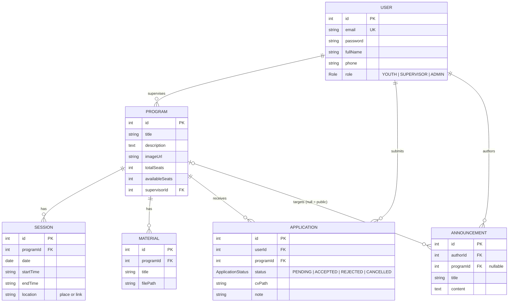

# Sanad Youth — Backend API

منصة "Sanad Youth" الرقمية: Backend API لإدارة البرامج التدريبية والورشات للشباب.
**الستاك:** NestJS 10 · TypeScript · Prisma 5 · PostgreSQL · Redis (BullMQ) · JWT · Multer · Throttler · cache-manager

## التشغيل السريع (Windows + VS Code)

المتطلبات: Node.js 18+ و Docker Desktop.

```bash
npm install                      # يشغّل prisma generate تلقائيًا
copy .env.example .env           # ثم عدّل JWT_SECRET
npm run infra:up                 # PostgreSQL + Redis عبر docker compose
npx prisma migrate dev --name init
npm run db:seed                  # أدمن + مشرف + برنامج تجريبي
npm run start:dev                # http://localhost:3000
```

حسابات الـ Seed: الأدمن `admin@sanad.local / Admin@12345`، المشرفان `supervisor@sanad.local` و `supervisor2@sanad.local` (`Supervisor@12345`)، الشباب `youth1..3@sanad.local` (`Youth@12345`). الـ seed ينشئ 4 برامج (أحدها ممتلئ) وطلبات بكل الحالات وإعلانات.

اختبار آخر مقعد (والسيرفر شغّال): `node test-race-condition.js 30`

## مخطط العلاقات (ERD)



* **User ↔ Program (متعدد لمتعدد)** يتم عبر الجدول الوسيط `Application` مع قيد فريد `@@unique([userId, programId])` (لا تقديم مرتين).
* **Program → Session/Material/Announcement:** واحد لمتعدد.
* الفهارس: `Program(supervisorId, title, createdAt)`, `Application(programId,status)`, `Application(userId,status)`, `Session(programId,date)`, `Announcement(programId,createdAt)`.

## قرارات التصميم

| الموضوع | القرار |
|---|---|
| **آخر مقعد** | داخل `Interactive Transaction` يتم حجز المقعد بتحديث ذري مشروط: `updateMany where availableSeats > 0 data decrement 1`. PostgreSQL يقفل الصف فتتسلسل الطلبات المتزامنة؛ الفائز يأخذ `201` والباقي `409 No seats available`. إن فشل إنشاء الطلب يُلغى الخصم (rollback). |
| **تحرير المقعد** | الرفض/الإلغاء يغيّرون الحالة بـ `updateMany where status IN (...)` ثم يزيدون المقاعد مرة واحدة فقط (لا double-release حتى لو تزامن الإلغاء مع الرفض). |
| **إعادة التقديم** | الطلب `CANCELLED` يمكن إعادته (`PENDING`) بنفس الصف؛ `PENDING/ACCEPTED/REJECTED` يرجع `409`. |
| **الطوابير** | بعد نجاح الـ Transaction فقط: `emailQueue.add(...)` بـ IDs فقط، `jobId` ثابت لمنع التكرار، `attempts: 3`، `backoff` أسّي، `removeOnComplete`. فشل Redis لا يُفشل التسجيل. |
| **الكاش** | تفاصيل/قائمة البرامج والإعلانات مخزّنة؛ أي إضافة/تعديل/تغيير مقاعد يمسح مجموعة الكاش فورًا (`AppCache.invalidate`). الكاش بالذاكرة؛ مع أكثر من نسخة من السيرفر استخدم Redis store. |
| **التوكنات** | Access Token قصير (`15m`، سر `JWT_SECRET`) + Refresh Token طويل (`7d`، سر `JWT_REFRESH_SECRET` مختلف). الـ Refresh يُخزَّن **مُجزّأ (SHA-256)** في جدول `RefreshToken`، ويُدوَّر عند كل تجديد (يُستعمل مرة واحدة). استعمال توكن قديم = اشتباه سرقة فتُلغى كل جلسات المستخدم. |
| **معالجة الأخطاء** | `try/catch` في `AuthService`، والديكوريتر `@HandleErrors()` يغلّف كل دوال الـ Services، وفلتر عام `AllExceptionsFilter` يحوّل أخطاء Prisma (`P2002→409`, `P2025→404`, ...) إلى استجابة JSON موحّدة. |
| **الملفات** | `diskStorage` + `randomUUID()`، يخزَّن المسار فقط. الصور عامة عبر `/uploads`. **الـ CV والمواد خاصة**: `/uploads/cvs` و `/uploads/materials` محجوبة (403) وتُحمَّل فقط عبر endpoints تتحقق من الصلاحية (المادة: `ACCEPTED` فقط). |
| **الخصوصية** | `password` لا يُختار أبدًا (`safeUserSelect`) + `ClassSerializerInterceptor` عام. |
| **Throttler** | عام 100/دقيقة، `login` و `register` 5/دقيقة، `GET /health` معفى، `trust proxy = 1`. |

## الـ Endpoints

كل الطلبات (عدا auth و health) تحتاج `Authorization: Bearer <token>`.

### عام
| Method | Path | الوصف |
|---|---|---|
| GET | `/health` | فحص الحالة (بدون throttle) |
| POST | `/auth/register` | إنشاء حساب شاب (5/دقيقة) |
| POST | `/auth/login` | تسجيل دخول (5/دقيقة) → `accessToken` + `refreshToken` |
| POST | `/auth/refresh` | `{refreshToken}` → زوج توكنات جديد (Rotation، 10/دقيقة) |
| POST | `/auth/logout` | `{refreshToken}` إلغاء الجلسة الحالية |
| POST | `/auth/logout-all` | إلغاء كل جلسات المستخدم (يحتاج Access Token) |
| GET | `/users/me` | بياناتي |
| GET | `/programs?page=&limit=&search=` | تصفح البرامج (Pagination + بحث) |
| GET | `/programs/:id` | تفاصيل البرنامج + المشرف + المقاعد المتبقية + الجلسات |

### الشاب (YOUTH)
| Method | Path | الوصف |
|---|---|---|
| POST | `/programs/:programId/applications` | تقديم طلب (`multipart`: `cv` PDF اختياري، `note`) |
| GET | `/applications/my?status=&page=&limit=` | طلباتي فقط |
| PATCH | `/applications/:id/cancel` | إلغاء طلبي (يحرّر المقعد) |
| GET | `/applications/:id/cv` | تحميل سيرتي الذاتية |
| GET | `/announcements/public` | الإعلانات العامة |
| GET | `/announcements/feed` | عامة + إعلانات برامجي |
| GET | `/announcements/program/:programId` | إعلانات برنامج مسجّل فيه |
| GET | `/programs/:programId/materials` | مواد البرنامج (ACCEPTED فقط) |
| GET | `/materials/:id/download` | تحميل مادة (ACCEPTED فقط) |

### المشرف (SUPERVISOR) — برامجه فقط
| Method | Path | الوصف |
|---|---|---|
| GET | `/programs/managed` | برامجي |
| PATCH | `/programs/:id` | تعديل العنوان/الوصف |
| POST | `/programs/:id/image` | صورة الغلاف (`image`: jpeg/png/webp ≤ 2MB، تُحذف القديمة) |
| POST | `/programs/:programId/sessions` | إضافة جلسة `{date, startTime, endTime?, location}` |
| PATCH/DELETE | `/sessions/:id` | تعديل/حذف جلسة |
| POST | `/programs/:programId/materials` | رفع مادة (`file` PDF ≤ 5MB + `title`) |
| DELETE | `/materials/:id` | حذف مادة |
| GET | `/programs/:programId/applications` | المتقدمون لبرنامجي |
| POST/DELETE | `/announcements` , `/announcements/:id` | إعلان لبرنامجي (`programId` إلزامي) |

### الأدمن (ADMIN)
| Method | Path | الوصف |
|---|---|---|
| POST | `/users/supervisors` | إضافة مشرف |
| GET | `/users/supervisors` | قائمة المشرفين |
| POST | `/programs` | إنشاء برنامج وتعيين مشرف `{title, description, totalSeats, supervisorId}` |
| PATCH/DELETE | `/programs/:id` | تعديل (بما فيه المقاعد والمشرف) / حذف |
| GET | `/applications?status=&programId=&search=` | كل الطلبات |
| PATCH | `/applications/:id/review` | `{ "status": "ACCEPTED" \| "REJECTED" }` (من PENDING فقط) |
| POST | `/announcements` | إعلان عام (بدون `programId`) أو لبرنامج |

## سيناريو العرض (Demo)

1. `POST /auth/register` ثم `POST /auth/login` (شاب) → احفظ `accessToken` و `refreshToken`؛ بعد انتهاء الـ access استعمل `POST /auth/refresh`.
2. `GET /programs?search=lead` ثم `GET /programs/1`.
3. `POST /programs/1/applications` (Postman: form-data، `cv` = PDF) → `PENDING`.
4. الأدمن: `PATCH /applications/1/review {"status":"ACCEPTED"}`.
5. الشاب: `GET /applications/my` → `ACCEPTED` ثم `GET /programs/1/materials`.
6. `node test-race-condition.js 30` → مقعد واحد فقط، الباقي `409`.
7. جرّب 6 محاولات login متتالية → الطلب السادس `429`.

## هيكل المشروع

```
prisma/        schema.prisma, seed.ts
src/
  common/      guards, decorators, upload util, AppCache, dto
  auth/ users/ programs/ (programs + sessions + materials)
  applications/ (service + EmailProcessor worker)  announcements/  health/
test-race-condition.js
```
